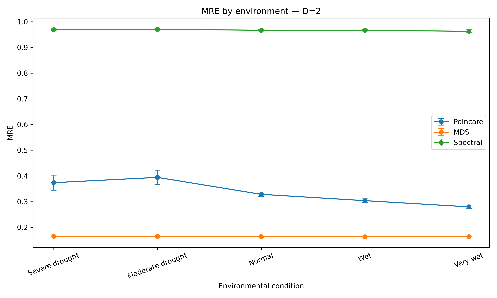

# Maize–AMF Network Embedding

**A computational comparison of Poincaré, MDS, and spectral representations of coupled maize root–fungus networks.**

Raven V. Santos · Akhira S. Manlangit · Erra Nicole F. De Guzman  
Research adviser: John Dave T. Bonilla

This repository accompanies our study, *In Silico Optimization of Zea mays–Arbuscular Mycorrhizal Fungi Networks: A Hyperbolic Embedding Framework for Modeling Nutrient Uptake Dynamics*.

We investigate how embedding geometry and dimension affect the representation of maize root–AMF networks and the transport quantities computed from them. We provide our experiment code, complete simulation output, statistical analysis, and the files needed to inspect and reproduce the reported comparisons.

## Explore the study

| I want to… | Start here |
|---|---|
| Understand the experiment | [Methods and interpretation](METHODS.md) |
| Download all 17,550 model runs | [Complete results CSV](FINAL_EXP_RESULTS.csv) |
| Understand the data columns | [Data dictionary](DATA_DICTIONARY.md) |
| Inspect the experiment | [EXP.py](EXP.py) |
| Inspect the statistical analysis | [STATS.py](STATS.py) |
| Run the analysis on my computer | [Reproduction guide](REPRODUCIBILITY.md) |
| Find the statistical tables and figures | [Output catalogue](OUTPUTS.md) |
| Access the manuscript appendices | [Appendix A and B resources](APPENDIX_LINKS.md) |

## Study design

| Component | Configuration |
|---|---|
| Root architecture files | 78 RSML/XML files from Wu's lateral-root dataset |
| Environmental scenarios | Severe drought, moderate drought, normal, wet, very wet |
| Embedding methods | Poincaré, multidimensional scaling, spectral embedding |
| Embedding dimensions | 2, 16, 32 |
| Stochastic seeds | 42, 123, 456, 789, 1011 |
| Model-run records | 17,550 |
| Seed-averaged file-condition records | 3,510 |

We average the five stochastic runs within each file and experimental condition before inferential testing. These repeated conditions do not increase the number of root files or establish biological independence.

## Main findings

Across the archived results, MDS has the lowest mean relative reconstruction error (0.0978), while Poincaré has the lowest mean Stress (0.0656). MDS also has the highest mean edge-based transport preservation and simulated uptake-curve area. No method leads every evaluation criterion; the preferred representation depends on the quantity being preserved.



*An example result from our archived statistical figures. Error bars show standard errors across seed-averaged file values.*

## Reproduce the statistical analysis

After cloning or downloading this repository, install the analysis dependencies and run:

```bash
python -m pip install -r requirements-analysis-verified.txt
python validate_data.py
python run_analysis.py
python verify_reproduction.py
python run_sensitivity.py
```

Use a virtual environment; platform-specific setup and full experiment instructions are in the [reproduction guide](REPRODUCIBILITY.md). New outputs are written separately from the archived results. We retain `EXP.py` and `STATS.py` as the original implementations and use portable launchers to supply local paths.

## Data and interpretation

Our root geometry comes from [Wu's Lateral roots dataset, version 5](https://doi.org/10.6084/m9.figshare.4836890.v5). The [input manifest](rsml_input_manifest.csv) records the 78 filenames and their checksums. We provide the synthetic AMF node and edge inputs with the repository.

The scenario labels represent parameterized model conditions. The resistance, flux, and uptake values are computational proxies, not measured physiological outcomes. The AMF network is synthetic. Our [methods notes](METHODS.md) describe these assumptions and the 69-group sensitivity analysis.

## Verification

We reproduced all 12 archived statistical tables within the documented numerical tolerance and recovered the 69 exact MDS-output-signature groups used for sensitivity analysis. See [verification details](VALIDATION.md) for the environment and scope of these checks. The full embedding experiment has not been rerun as part of the repository verification.

## Cite this work

If you use our code or simulation output, please cite this repository and identify the release or commit you used. [CITATION.cff](CITATION.cff) provides the research team and repository metadata. Cite the original root dataset separately. [Appendix resources](APPENDIX_LINKS.md) include permanent links to the manuscript's original computational archive.

Reuse permissions for this repository have not yet been specified by a license. Third-party data remains subject to its original terms.

## Research computing reference

Our documentation and data-sharing practices are informed by Wilson et al. (2017), [Good enough practices in scientific computing](https://doi.org/10.1371/journal.pcbi.1005510), *PLOS Computational Biology*, 13(6), e1005510.
